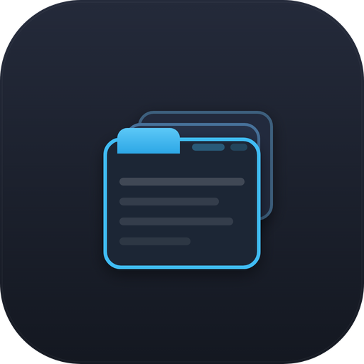

<p align="center">
  
</p>

<h1 align="center">Tabdeck Companion</h1>

<p align="center">
  <a href="https://github.com/tempus2016/tabdeck-companion/releases"></a>
  <a href="https://github.com/tempus2016/tabdeck-companion/releases"></a>
  <a href="https://github.com/hacs/default"></a>
  <a href="https://github.com/tempus2016/tabdeck-companion/blob/main/LICENSE"></a>
</p>

<p align="center">
  <a href="https://github.com/tempus2016/tabdeck-companion/actions/workflows/ci.yml"></a>
  <a href="https://github.com/tempus2016/tabdeck-companion/actions/workflows/hassfest.yml"></a>
  <a href="https://github.com/tempus2016/tabdeck-companion/actions/workflows/hacs.yml"></a>
  <a href="https://github.com/tempus2016/tabdeck-companion/wiki"></a>
  <a href="https://github.com/tempus2016/tabdeck-card"></a>
</p>

A small Home Assistant integration for the [Tabdeck card](https://github.com/tempus2016/tabdeck-card). Each browser's deck appears as a **select entity**: its options are the deck's tab names and its state is the open tab. Automations can read which tab a wall tablet shows, and change it with `select.select_option`.

```yaml
actions:
  - action: select.select_option
    target:
      entity_id: select.tabdeck_kitchen_tablet_main
    data:
      option: Cameras
```

## Install

Needs Home Assistant 2026.11 or later and the Tabdeck card 1.6.0 or later.

1. Open **Settings → Marketplace**, search for **Tabdeck Companion** and download it. If it doesn't show up, add `https://github.com/tempus2016/tabdeck-companion` as a custom repository of type **Integration** first. Or copy `custom_components/tabdeck` into your Home Assistant `config/custom_components/` folder by hand.
2. Restart Home Assistant.
3. **Settings → Devices & services → Add integration → Tabdeck Companion**. There is nothing to fill in.

## Turn it on in a deck

```yaml
type: custom:tabdeck-card
event_id: main          # the deck id in the entity name; set one so it doesn't change
companion: true
tabs: [ ... ]
```

The next time a browser opens that dashboard, a device **Tabdeck <browser>** appears with one select entity per deck, e.g. `select.tabdeck_kitchen_tablet_main`.

**Browser ids.** The card names the browser after, in order: the card's `companion_id` (only for a dashboard a single device shows), the Tabdeck device name set with `?tabdeck_device=kitchen_tablet` in the URL once, browser_mod's browser id, or a random id it keeps in that browser (`browser_1a2b3c4d`). Rename the device or entity in Home Assistant as usual.

## How it behaves

- **State:** the open tab. Only visible tabs you can open are options (navigation and action tabs aren't).
- **Selecting an option** switches every open window of that browser showing the deck. It's treated like the card's `remote_entity`: a tab with a PIN isn't opened unless its code was entered in that browser recently (the entity stays on the open tab), not remembered as the person's choice, and ignored during `quiet_hours`.
- **Unavailable** while no browser window shows the deck. The entity and its last tab list come back after a restart.
- **Removing a browser:** delete its device on the integration page. It comes back if that browser registers again.
- **Without the integration** a deck with `companion: true` works as before and sends nothing more.

## Usage stats

With `usage_stats: true` on a companion deck, the card reports how many minutes each tab was on screen (every 10 minutes, or every N with `usage_stats: N`). The deck then gets a sensor such as `sensor.tabdeck_kitchen_tablet_main_usage`: total minutes (`total_increasing`, so long-term statistics and Utility Meter helpers work), with minutes per tab in its `tabs` attribute, busiest first:

```yaml
{{ state_attr('sensor.tabdeck_kitchen_tablet_main_usage', 'tabs')['Cameras'] }}
```

## What it accepts

The card talks to Home Assistant over its normal, logged-in websocket connection, so only signed-in Home Assistant users can register decks. The integration accepts and stores only a browser id, a deck id, a browser label, the tab names, the open tab and minutes per tab (ids: 1-64 letters, digits, `_ . -`; at most 100 tabs of 100 characters; at most 200 decks). It reads nothing else from the browser and exposes nothing else.

Websocket commands (for other front-ends):

| Command | Fields | |
|---|---|---|
| `tabdeck/register` | `browser_id`, `deck_id`, `browser_name?`, `tabs`, `tab?` | Subscription. Sends `{ "command": "select", "tab": "…" }` events when the entity is set. |
| `tabdeck/update` | `browser_id`, `deck_id`, `tabs?`, `tab?` | The deck's tab list or open tab changed. |
| `tabdeck/usage` | `browser_id`, `deck_id`, `minutes` | Minutes per tab since the last report (added to the totals; at most a day per tab per report). |

## Documentation

The [wiki](https://github.com/tempus2016/tabdeck-companion/wiki) covers installation, the select entity, the usage sensor, automation examples and troubleshooting.

## Development

```sh
python3 -m pytest
```

The tests cover the pure bookkeeping in `logic.py` and the static files. The Home Assistant glue (`__init__.py`, `select.py`, `config_flow.py`) is tested on a real Home Assistant instance.
