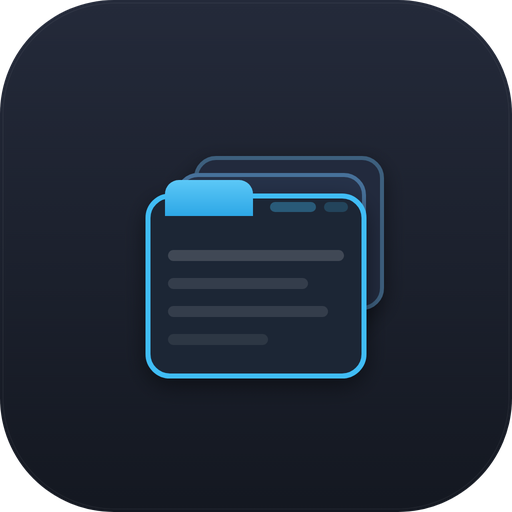

# Tabdeck Companion

A small Home Assistant integration for the [Tabdeck card](https://github.com/tempus2016/tabdeck-card). It makes each browser's deck a **select entity**, so automations can see which tab a wall tablet shows and switch it, and it can turn the minutes each tab is on screen into a **sensor**.

## Pages

- [Installation](Installation): Marketplace or manual install, adding the integration, turning it on in a deck.
- [Select entity](Select-Entity): what the entity shows, how switching works, PINs and quiet hours, browser names.
- [Usage sensor](Usage-Sensor): minutes per tab, long-term statistics and Utility Meter.
- [Automation examples](Automation-Examples): doorbell to cameras, follow the time of day, react to what's on screen.
- [Websocket API](Websocket-API): the `tabdeck/*` commands, for other front-ends.
- [Troubleshooting](Troubleshooting): no entity, entity unavailable, select does nothing.
- [Showcase](Showcase): automations people have shared.

## Requirements

- Home Assistant 2026.11 or later.
- Tabdeck card 1.6.0 or later.
